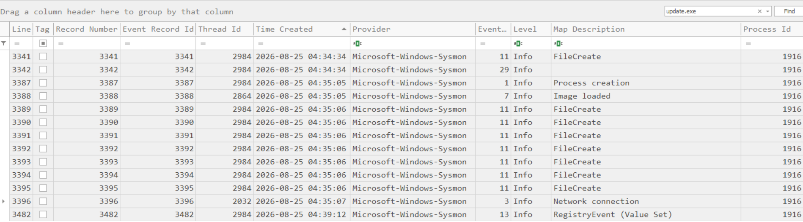
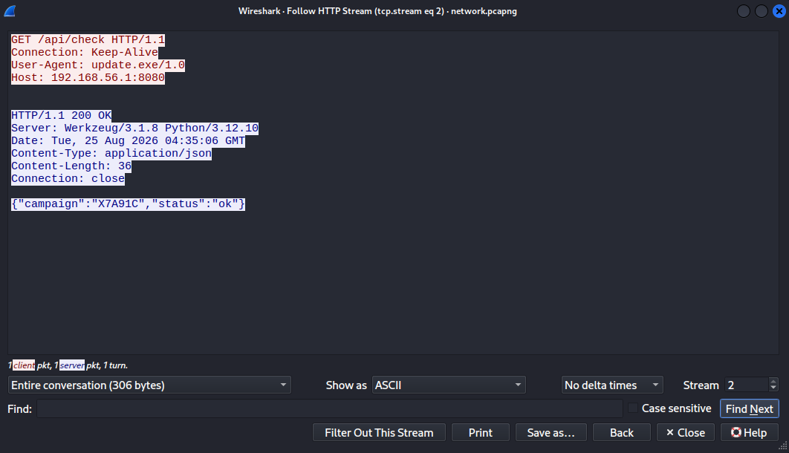

## VuVT
### Đề bài
Ring... tuttt... tuttt... <br>
SOC: Alo, Vũ ấy hả em. <br>
VuVT: Anh ơi, em chỉ chạy update thôi mà sao máy em tự nhiên bị mã hóa rồi... <br>
SOC: Đừng động vào máy nữa. Bọn anh sẽ kiểm tra. <br>
Một bộ dữ liệu được thu thập từ máy tính gặp sự cố. 
Hãy điều tra xem chuyện gì đã thực sự xảy ra và tìm ra thông tin cần thiết để khôi phục kết quả cuối cùng.

### Giải
Sau khi tải về và giải nén thì được file gói tin mạng `network.pcapng`, bộ nhớ `mem.raw`, log `sysmon.evtx`, thư mục `Users` trong đó có chứa các file bị mã hóa `.enc` tại `Users\Public\MetaData\Data`. Tiến hành parse `sysmon.evtx` bằng EvtxCmd và dùng TimelineExplorer để phân tích.

Có thể thấy người dùng đã bị ransomware khiến cho các file bị mã hóa. Từ log sysmon, tìm các sự kiện liên quan đến file `.enc` thì thấy các file này được tạo từ tiến trình `update.exe`, pid: 2844 vào lúc `2026-08-25 04:35:06`
``` json
{"EventData":{"Data":[{"@Name":"RuleName","#text":"technique_id=T1047,technique_name=File System Permissions Weakness"},{"@Name":"UtcTime","#text":"2026-08-25 04:35:06.006"},{"@Name":"ProcessGuid","#text":"bad0321b-1b79-6a8d-b600-000000000500"},{"@Name":"ProcessId","#text":"2844"},{"@Name":"Image","#text":"C:\\Users\\bkav\\Downloads\\UpdateX7A91C\\update.exe"},{"@Name":"TargetFilename","#text":"C:\\Users\\Public\\MetaData\\Data\\1337dakl.txt.enc"},{"@Name":"CreationUtcTime","#text":"2026-08-25 04:35:06.006"},{"@Name":"User","#text":"DESKTOP-7NNKNIK\\bkav"}]}}
```

Điều tra `update.exe` thì thấy file được tạo từ `UpdateX7A91C.7z` (được tải bởi `browser_broker.exe` từ `http://192.168.56.1:1337/UpdateX7A91C.7z`). `update.exe` thực hiện mã hóa các file của người dùng và mở kết nối từ `192.168.56.10:49674` tới `192.168.56.1:8080`


Sử dụng volatility 3 để phân tích `mem.raw`. Sử dụng lệnh `vol -f mem.raw windows.pslist` thì thấy tiến trình 2844 `update.exe` (ransomware) vẫn đang chạy. Thực hiện trích xuất file thực thi.
```bash
vol -f mem.raw -o output/ windows.dumpfiles --pid 2844
```

Thực hiện reverse bằng ida, chương trình thực hiện các bước sau:
- Lấy tên máy tính bằng hàm `GetComputerNameA` và được chuyển thành chữ thường
- Lấy ProcessID bằng `GetCurrentProcessId`
- Gửi `GET` đến `http://192.168.56.1:8080/api/check` và lấy field `campaign`
- Ghép 3 trường cho khóa AES-256-GCM
- Ghi file mã hóa
  | Offset | Kích thước | Nội dung |
  | - | - | - |
  | `0x00` | 8 | magic byte: `1337DaKL` |
  | `0x08` | 16 | tag GCM |
  | `0x18` | | ciphertext |
- Ghi đè xóa key trong RAM

Sử dụng wireshark để phân tích file `network.pcapng`. Lọc tìm kết nối từ ip máy nạn nhân `192.168.56.10:49674` đến máy C2 `192.168.56.1:8080` với yêu cầu `GET`. Stream 2 thỏa mãn yêu cầu này cùng với trường campaign: `X7A91C`


Vậy khóa sẽ là SHA256(desktop-7nnknik|2844|X7A91C), từ công thức của khóa AES-256-GCM thì có thể tìm được iv từ ciphertext, key, tag bằng công thức
```
H          = AES_K(0^128)
S          = GHASH_H(A || C || pad || 0^64 || len(C)·8)
AES_K(J0)  = T xor S
J0         = AES_K^-1(T xor S)
iv      = J0[0:12]
```

Sử dụng script để tìm iv và thực hiện giải mã các file
``` python
import glob, hashlib, os
from cryptography.hazmat.primitives.ciphers import Cipher, algorithms, modes
from cryptography.hazmat.primitives.ciphers.aead import AESGCM

DIR = r".\encrypted_files"
KEY = hashlib.sha256(b"desktop-7nnknik|2844|X7A91C").digest()
ecb = Cipher(algorithms.AES(KEY), modes.ECB())


def gmul(x, y):
    z = 0
    for i in range(127, -1, -1):
        if (y >> i) & 1:
            z ^= x
        x = (x >> 1) ^ (0xE1 << 120) if x & 1 else x >> 1
    return z


def ghash(h, data):
    y = 0
    for i in range(0, len(data), 16):
        y = gmul(y ^ int.from_bytes(data[i:i + 16], "big"), h)
    return y


H = int.from_bytes(ecb.encryptor().update(bytes(16)), "big")

for path in glob.glob(os.path.join(DIR, "*.enc")):
    d = open(path, "rb").read()
    tag, ct = d[8:24], d[24:]                       # magic(8) | tag(16) | ciphertext
    data = ct + bytes(-len(ct) % 16) + bytes(8) + (len(ct) * 8).to_bytes(8, "big")
    t = int.from_bytes(tag, "big") ^ ghash(H, data)  # AES_K(J0) = T xor S
    nonce = ecb.decryptor().update(t.to_bytes(16, "big"))[:12]  # J0[0:12]
    open(path[:-4], "wb").write(AESGCM(KEY).decrypt(nonce, ct + tag, None))
    print(path, "->", path[:-4])
```

flag được tìm thấy sau khi giải mã file `hi.txt.enc`

FLAG: **CSCV2026{c0rr3l4t3_b3f0r3_d3crypt}**