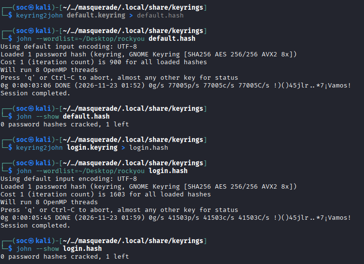
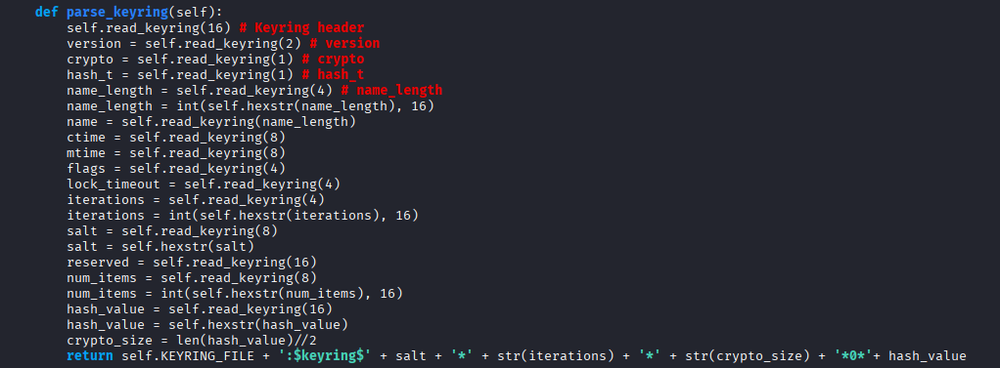
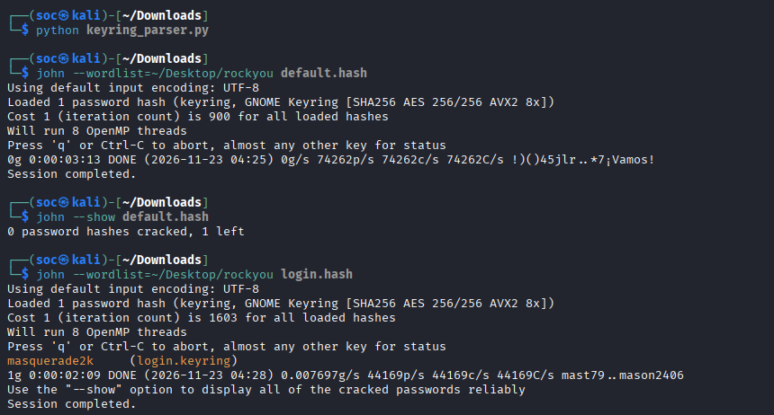

# Gnome Breaker
## Đề bài
I need you to break the secrets. The secrets to the flag are inside are hidden in the same file with wifi passwords,login passwords... Find IT and break it.I didn't leave a strong password I think you can find it somewhere.

Flag format: `ECSC{string}`

## Giải
Sau khi tải về và giải nén thì được thư mục từ máy Linux. Đề bài có nhắc đến flag được cất giấu cùng với mật khẩu wifi, mật khẩu đăng nhập. Điều này cùng với tên đề bài Gnome khiến mình nghĩ đến Gnome keyring - dịch vụ hệ thống đóng vai trò như một két sắt bảo mật lưu trữ thông tin xác thực cho người dùng trên môi trường desktop. Toàn bộ dữ liệu mật khẩu được lưu tại `home//.local/share/keyrings/`. Tại đây có 2 file `default.keyring` và `login.keyring`

Ban đầu mình sử dụng keyring2john để trích xuất và phá khóa. Tuy nhiên thì phá khóa thất bại ở cả 2 file


Kiểm tra output thì thấy ciphertext chỉ có độ dài 16 bytes, phần đuôi là hex của cụm `appl` và `xdg:` vốn là phần thuộc tính chứ không phải ciphertext
```
default.keyring:$keyring$d272cc2faa9d5690*900*16*0*00000000000000020000000b6170706c
login.keyring:$keyring$4a24e2c4bd9f555c*1603*16*0*00000000000000010000000a7864673a
```

Kiểm tra code của `keyring2john.py`. Có thể thấy công cụ đã được hardcode bỏ qua các trường tên, thuộc tính và lấy cố định 16 bytes làm ciphertext khiến parse bị sai


Theo cấu trúc chuẩn của Genome: [Link](https://wiki.gnome.org/Projects(2f)GnomeKeyring(2f)KeyringFormats(2f)FileFormat.html) thì các trường tên, số thuộc tính, số phần tử không cố định, thực hiện viết script trích xuất lại.
```python
from pathlib import Path
import struct

paths = sorted(Path("./gnome/home/masquerade/.local/share/keyrings").glob('*.keyring'))

class Reader:
    def __init__(self, data):
        self.data, self.pos = data, 0
    def take(self, n):
        value = self.data[self.pos:self.pos+n]
        assert len(value) == n
        self.pos += n
        return value
    def u32(self):
        return struct.unpack('>I', self.take(4))[0]
    def string(self):
        n = self.u32()
        return None if n == 0xffffffff else self.take(n)

for path in paths:
    r = Reader(path.read_bytes())
    assert r.take(16) == b'GnomeKeyring\n\r\x00\n'
    assert r.take(4) == bytes(4)
    name = r.string()
    r.take(24)
    iterations = r.u32()
    salt = r.take(8)
    r.take(16)
    items = r.u32()
    for _ in range(items):
        r.take(8)
        for _ in range(r.u32()):
            r.string()
            typ = r.u32()
            if typ == 0:
                r.string()
            elif typ == 1:
                r.u32()
            else:
                raise ValueError(typ)
    ciphertext = r.take(r.u32())
    assert r.pos == len(r.data)

    hash = f'{path.name}:$keyring${salt.hex()}*{iterations}*{len(ciphertext)}*0*{ciphertext.hex()}'

    Path(f"{path.stem}.hash").write_text(hash + "\n", encoding="utf-8")
```
Kết quả thu được 2 output mới với chiều dài ciphertext lần lượt là 208 bytes và 160 bytes
```
default.keyring:$keyring$d272cc2faa9d5690*900*208*0*8c77665879df4202f6e695fe84ff76360afcfcb8f0ca91eca385b3119105f884764078008532fa6043bb2f68fd00871014e5a3dbae749be2b8bbdf4b7f28ce251d2ba3b05715fddc35d9939b4ebde273f7f674adfbf9788e9ae3ac284bdf147ac21bd6d320f66ddb7086e8df52a64c425441462092c7729cc985e06c710c99b428799a6b7a05d50413f04e8cd00504089b41bee540e0eb8a6da35759c8acd81ab157d47173f90d9bb564efaf7f3d0ef83d8777d3afd085bdfe5e23221998c3272831653ffcad84d2ddb39a0a57ad0346
login.keyring:$keyring$4a24e2c4bd9f555c*1603*160*0*113e63748682be6fdf84e270e02843856ac6782c83c242fef58a474ef0d1046860c1913e36a0763a99188f6e2c976d9f6d0c43d5549b5c9d26247fec49ffa7e29baae9adf069113fa77e7edc32a5cb7c3dbf0889f2540dd79cc9ab93f37b27df17baf6ff4c97ec586e3e793132f0cc0e2e35c672ccbba4b7e1ba2fb6116670fab6396ceeba8941d5d706917cc442a55b8c753661fefb68e14f2a4f4e75a978e4
```

Sử dụng john the ripper để crack 2 khóa này thì `login.hash` đã crack thành công với key `masquerade2k `


Viết script giải mã và tìm được flag
``` python
import hashlib
from Crypto.Cipher import AES

password = "masquerade2k"

with open("login.hash", "r", encoding="utf-8") as f:
    data = f.read().strip()

payload = data.split("$")[2]
salt_hex, iterations_str, _, _, ciphertext_hex = payload.split("*")

salt = bytes.fromhex(salt_hex)
iterations = int(iterations_str)
ciphertext = bytes.fromhex(ciphertext_hex)

digest = hashlib.sha256(password.encode() + salt).digest()
for _ in range(iterations - 1):
    digest = hashlib.sha256(digest).digest()

key = digest[:16]
iv  = digest[16:]

plaintext = AES.new(key, AES.MODE_CBC, iv).decrypt(ciphertext)
print(plaintext)

#b'\xf6Q\x01\xe1\x87\xdb}L\x18h\xce\x85i\xc4X\xc0\x00\x00\x00\x04Flag\x00\x00\x00 ECSC{C0ngrats_you_are_AGnomeFan}\x00\x00\x00\x00h\x06\t5\x00\x00\x00\x00\x00\x00\x00\x00\xff\xff\xff\xff\x00\x00\x00\x00\x00\x00\x00\x00\x00\x00\x00\x00\x00\x00\x00\x00\x00\x00\x00\x01\x00\x00\x00\nxdg:schema\x00\x00\x00\x00\x00\x00\x00\x16org.gnome.keyring.Note\x00\x00\x00\x00\x00\x00\x00\x00\x00\x00\x00\x00\x00\x00\x00\x00'
```

FLAG: **ECSC{C0ngrats_you_are_AGnomeFan}**