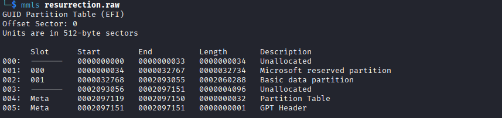
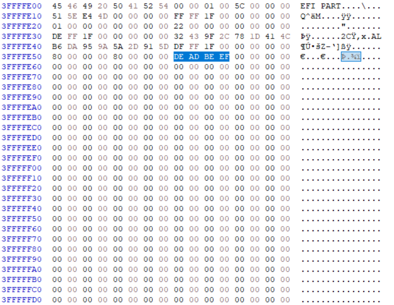
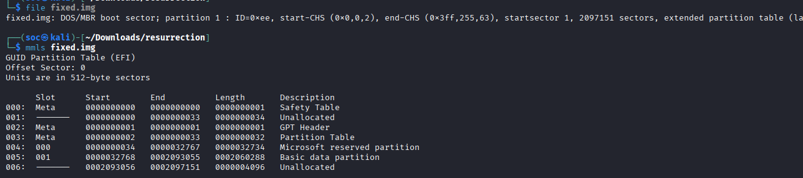
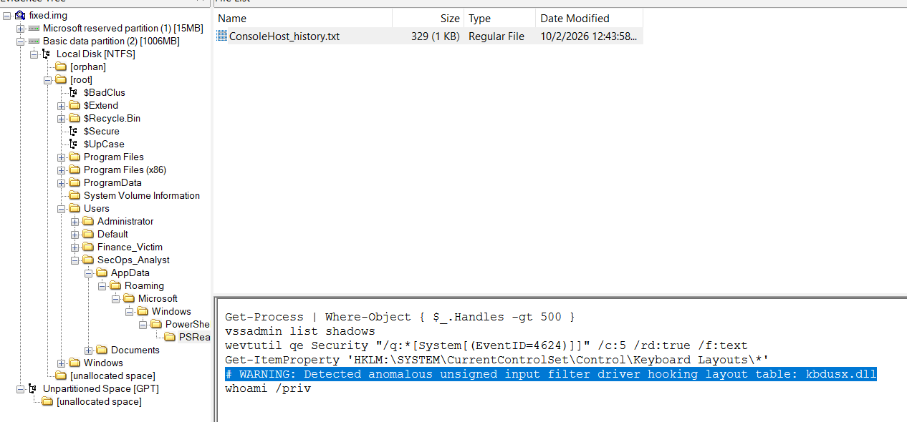
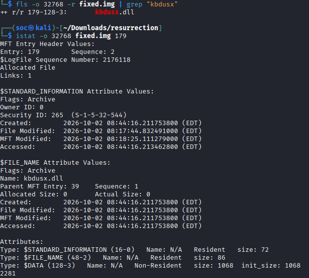
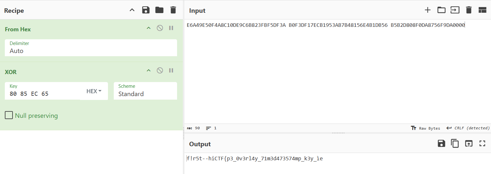
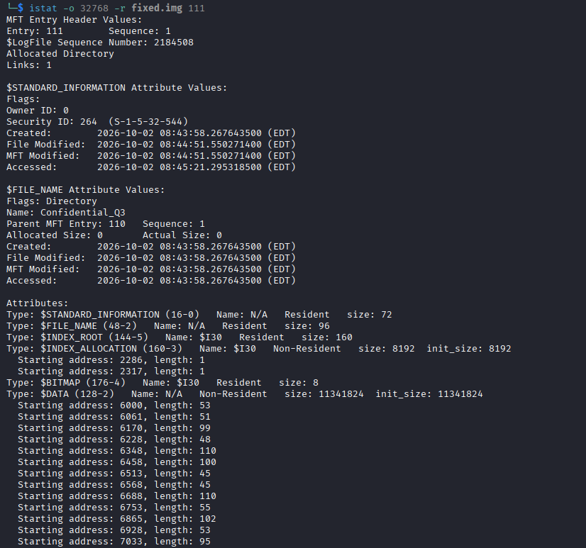
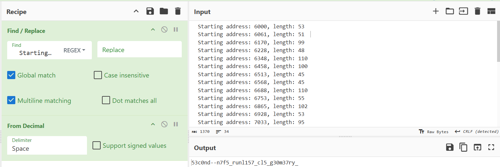
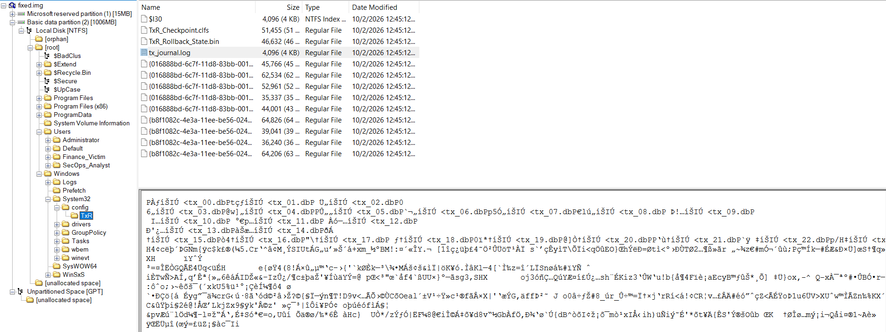
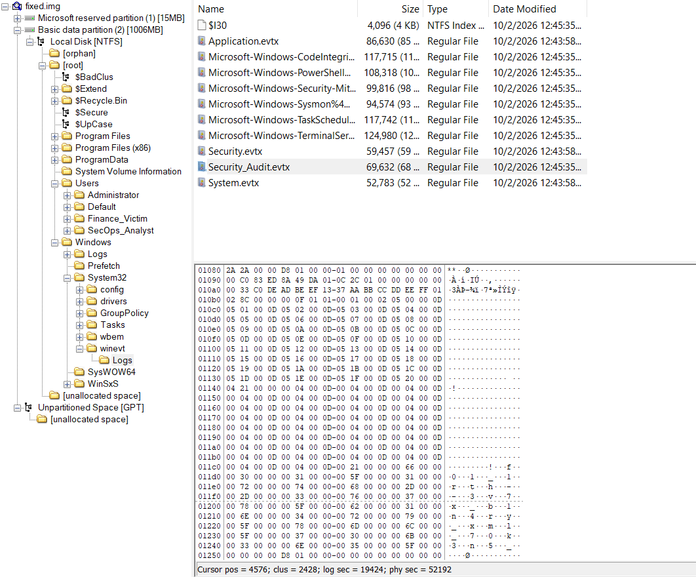

# RESURRECTION (Operation Eclipse Void)
## Đề bài
Tier-0 infrastructure collapsed under an absolute scorched-earth purge. The beacon exists solely within the silent spaces: Shattered-Geometry, Chrono-Echoes, and Unmapped-Voids. Recover the transmission from the wreckage. Each recovered phase reveals an ordinal identifier tag. Concatenate all five payload segments in order.

## Giải
Sau khi tải về thì được file `resurrection.raw`. Công cụ FTK Imager không thể mở file này, lệnh file thì trả về kết quả data. Khi kiểm tra bằng Sleuth Kit thì thấy đây là disk image chuẩn GPT. Mở bằng HxD thì thấy toàn bộ phần header, mảng entry GPT và boot sector đã bị ghi đè bằng bit 0. 


Phần backup header còn nhưng trường CRC bị sửa thành `0xDEADBEEF`. Phần backup mảng entry và backup boot sector NTFS còn nguyên vẹn.


Sử dụng script để khôi phục lại ổ đĩa:
- Tính và lưu lại CRC của backup header, backup mảng entry
- copy phần backup header, backup mảng entry thay cho phần lỗi.
- cập nhật currentLBA, backupLBA, Starting LBA of partition entries và CRC
- Tạo protective MBR ở đầu
- Tìm các phân vùng có dữ liệu và sửa lại boot sector lỗi bằng backup boot sector
``` python
import shutil
import struct
import zlib

S = 512

shutil.copyfile("resurrection.raw", "fixed.img")
with open("fixed.img", "r+b") as f:
    f.seek(0, 2)
    size = f.tell()
    last = size // S - 1

    def rd(lba, n=1):
        f.seek(lba * S)
        return f.read(n * S)

    def wr(lba, data):
        f.seek(lba * S)
        f.write(data)

    # doc backup GPT
    h = bytearray(rd(last))
    assert h[:8] == b"EFI PART", "backup GPT header not found"
    hsize = struct.unpack("<I", h[12:16])[0]
    ent_lba, n_ent, ent_sz = struct.unpack("<QII", h[72:88])
    entries = rd(ent_lba, n_ent * ent_sz // S)

    # sửa CRC trong backup 
    struct.pack_into("<I", h, 88, zlib.crc32(entries))          # CRC mang entry
    struct.pack_into("<I", h, 16, 0)
    struct.pack_into("<I", h, 16, zlib.crc32(bytes(h[:hsize])))  # CRC header
    wr(last, bytes(h))

    # header chính
    p = bytearray(h)
    struct.pack_into("<Q", p, 24, 1)         # currentLBA
    struct.pack_into("<Q", p, 32, last)      # backupLBA
    struct.pack_into("<Q", p, 72, 2)         # Starting LBA of partition entries
    struct.pack_into("<I", p, 16, 0)         # CRC
    struct.pack_into("<I", p, 16, zlib.crc32(bytes(p[:hsize])))
    wr(1, bytes(p))

    # mảng entry chính 
    wr(2, entries)

    # protective MBR 
    mbr = bytearray(S)
    mbr[446:462] = (b"\x00\x00\x02\x00" + b"\xEE" + b"\xFF\xFF\xFF"
                    + struct.pack("<II", 1, min(last, 0xFFFFFFFF)))
    mbr[510:512] = b"\x55\xAA"
    wr(0, bytes(mbr))

    #boot sector NTFS 
    first_data = None
    for i in range(n_ent):
        e = entries[i * ent_sz:(i + 1) * ent_sz]
        if not any(e):
            continue
        start, end = struct.unpack("<QQ", e[32:48])
        if rd(end)[3:11] == b"NTFS    ":     # partition có backup boot sector
            wr(start, rd(end))
            first_data = (start, end)
```

Sau khi sửa lại thì các công cụ đã có thể đọc file


Đề bài yêu cầu tìm 5 mảnh để ghép lại thành flag.

### Mảnh 1
Khi mở file bằng FTK Imager, file `ConsoleHost_history.txt` tại `\Users\SecOps_Analyst\AppData\Roaming\Microsoft\Windows\PowerShell\PSReadLine` có một dòng comment đến thư viện `kbdusx.dll`. Thời điểm file thay đổi ở trường `$STANDARD_INFORMATION` lại không khớp với trường `$FILE_NAME`



Trích xuất thư viện và kiểm tra bằng Detech It Easy thì thấy file có Overlay. Khi lấy phần overlay này XOR với timestamp từ chính file PE thì tìm được flag


FLAG FRAGMENT: **hiCTF{p3_0v3rl4y_71m3d473574mp_k3y_**

### Mảnh 2
Trong các bản ghi `$MFT`, có bản ghi 111 của `Confidential_Q3` là thư mục nhưng lại có trường `$DATA` vốn chỉ có ở file. Bên trong đó chứa các đoạn nhỏ là mã ASCII của mảnh flag. 



FLAG FRAGMENT: **n7f5_runl157_cl5_g30m37ry_**

### Mảnh 3
Tiếp tục tìm kiếm thì mình có thấy file `tx_journal.log` tại `Windows\System32\config\TxR`. Đây vốn là thư mục lưu trữ log ghi/sửa đổi registry key của Windows, mình cũng không tìm thấy tài liệu nào về file này nằm tại thư mục này. 

Kiểm tra kỹ hơn thì file này có cấu trúc tương tự USN Journal. Sử dụng MFTECmd kiểm tra thì file có 34 bản ghi, bản ghi đầu tiên có timestamp `133500000000000000` (2024‑01‑17 21:20:00 UTC), các bản ghi tiếp theo cách nhau 1 ms cùng với một số lẻ. Số lẻ này khi cộng với 16 thì ra chuỗi ASCII. VIết script python giải mã
```python
import struct

data = open("tx_journal.log", "rb").read()

stamps, pos = [], 0
while pos + 80 <= len(data) and int.from_bytes(data[pos:pos+4], 'little') == 80:
    stamps.append(int.from_bytes(data[pos+32:pos+40], 'little'))
    pos += 80

print(''.join(chr(stamps[i] - stamps[i-1] - 10000 + 16) for i in range(1, len(stamps))))

# th1jd--7r4ns4c710n_n4n0_f1l371m3_
```

FLAG FRAGMENT: **7r4ns4c710n_n4n0_f1l371m3_**

### Mảnh 4
Khi kiểm tra các file log tại thư mục `Windows\System32\winevt\Logs` thì thấy file lạ không có trong Windows mặc định `Security_Audit.evtx`. Bên trong chỉ có duy nhất 1 bản ghi với chuỗi đánh dấu lạ `0xDEADBEEF1337AABBCCDDEEFF`. BinXML khai báo 33 giá trị bool (0 và 1) nhưng phía dưới giá trị lại là số ascii tạo thành mảnh 4: `f01_1rth--3v7x_b1n4ry_xml_70k3n5_`


FLAG FRAGMENT: **3v7x_b1n4ry_xml_70k3n5_**

### Mảnh 5
Trong đề bài có nhắc đên Unmapped-Voids khiến mình nghĩ đến việc kiểm tra so khớp giữa `$Bitmap` và `$MFT`, Sử dụng script để quét thì thấy có 40 cluster được đánh dấu cấp phát nhưng lại không tồn tại trong `$MFT`, khoảng cách giữa giữa các cluster (53, 49, 102, 55, 104, 45, 45, …) là mã ASCII.
``` python
import struct

mft = open("$MFT", 'rb').read()
bitmap = open("$Bitmap", 'rb').read()
total = 257535

# Các cluster được sở hữu bởi file   
owned = set()
for i in range(len(mft) // 1024):
    r = bytearray(mft[i*1024:(i+1)*1024])
    if r[:4] != b'FILE':
        continue
    uo, un = struct.unpack('<HH', r[4:8])
    for k in range(un - 1): 
        r[k*512+510:k*512+512] = r[uo+2+2*k:uo+4+2*k]
    a = struct.unpack('<H', r[20:22])[0]
    while a + 8 <= 1024:
        t, ln = struct.unpack('<II', r[a:a+8])
        if t == 0xFFFFFFFF or ln == 0:
            break
        if r[a+8]:
            p, lcn = a + struct.unpack('<H', r[a+32:a+34])[0], 0
            while p < a + ln and r[p]:
                ls, os_ = r[p] & 15, r[p] >> 4
                length = int.from_bytes(r[p+1:p+1+ls], 'little')
                if os_:
                    lcn += int.from_bytes(r[p+1+ls:p+1+ls+os_], 'little', signed=True)
                    owned.update(range(lcn, lcn + length))
                p += 1 + ls + os_
        a += ln

# Cluster $Bitmap đánh dấu đã cấp phát nhưng không file nào sở hữu
orphans = [c for c in range(total) if (bitmap[c//8] >> (c % 8)) & 1 and c not in owned]
print(len(orphans), 'cluster mo coi:', orphans[:5], '...')

# Khoảng cách giữa 2 cluster mồ côi liên tiếp = mã ASCII
print(''.join(chr(orphans[i] - orphans[i-1]) for i in range(1, len(orphans))))

# 51f7h--b17m4p_orph4n_v01d_r35urr3c710n}
```

FLAG FRAGMENT: **b17m4p_orph4n_v01d_r35urr3c710n**

Ghép 5 mảnh flag lại thì được flag cuối cùng:

FLAG: **hiCTF{p3_0v3rl4y_71m3d473574mp_k3y_n7f5_runl157_cl5_g30m37ry_7r4ns4c710n_n4n0_f1l371m3_3v7x_b1n4ry_xml_70k3n5_b17m4p_orph4n_v01d_r35urr3c710n}**